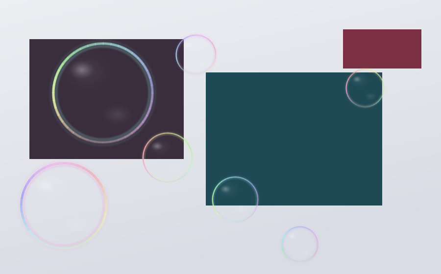

# BubbleGlass

**Windows 透明虹彩气泡层 —— 气泡中央真的能看见你的桌面。**



一层漂浮的气泡，边缘是细的虹彩色薄膜干涉线，中间完全透明。气泡底下就是你的真实桌面：
图标、窗口、视频都还在，鼠标可以照常点。它不是一个盖住屏幕的特效，而是一层画在桌面上的画。

单文件 C#，零第三方依赖，用系统自带的 .NET Framework 编译器就能构建。

> **English**: A transparent iridescent bubble overlay for Windows 10/11. Bubble centers are
> fully transparent, so your real desktop shows through in real time — nothing is captured or
> composited to a texture. One C# file, no dependencies, builds with the .NET Framework compiler
> that already ships with every Windows machine.

---

## 为什么没有 `.scr`

Windows 自带的 Bubbles 其实藏了三个未公开的注册表开关，开了之后气泡是玻璃材质、能浮在桌面上：

```
HKCU\Software\Microsoft\Windows\CurrentVersion\Screensavers\Bubbles
    MaterialGlass = 1    玻璃材质（中心透明，只剩边缘）
    ShowBubbles   = 1    背景用桌面截图，而不是黑底
    ShowShadows   = 1    投影
```

**在预览窗口里有效，真启动时退化成黑底。** 因为 Windows 8 之后，屏保进程被系统禁止截取桌面
（官方说法：屏保被禁止截屏，预览除外）。这不是配置问题，也没有 API 能绕过。

实测记录（同一份 exe，两种启动方式）：

| 启动方式 | 分层窗口 | `UpdateLayeredWindow` | 屏幕采样结果 |
|---|---|---|---|
| 普通启动（托盘） | OK | OK | 覆盖前后 86.4% 像素不变，纯黑像素 0.2% —— 透明区域就是实时桌面 |
| 系统屏保拉起（`/s`） | OK | OK | 中心 `BGRA = 0,0,0,0`，屏幕全黑 —— 桌面根本不在合成树里 |

API 全部返回成功、缓冲区里的 alpha 确实是 0，但 DWM 不把桌面合成给你。结论只有一条：
**屏保形态做不出「透视桌面」**。所以本项目只做托盘形态 —— 走普通窗口，DWM 正常合成，
气泡背后就是实时桌面。

## 特性

- **真透明**：气泡中心 alpha = 0，能看见并操作下层桌面，不是截图贴图
- **虹彩边缘**：边缘按入射角做薄膜干涉配色（HSL 0.74 / 0.76），带第二次干涉与柔光晕
- **碰撞**：气泡按半径作质量弹开，接触不穿透（实测最小间隙 0.00 px，恰好贴合）
- **丝滑**：自控帧循环 + `DwmFlush()` 对齐垂直同步，默认 60 fps
- **亚像素**：每个气泡预制 4 张相位精灵（0 / 0.5 px），落点误差 ≤ 0.25 px
- **零依赖**：只用 `System.Drawing` / `System.Windows.Forms`，不用装运行时、不用 NuGet

## 快速开始

需要 Windows 10 / 11 和 .NET Framework 4.x（系统自带）。

```bat
build.bat
```

产出 `BubbleGlass.exe`，也可以直接从 [Releases](../../releases) 下载。

`build.bat` 只依赖 .NET Framework 的编译器。它会在编译前顺手跑一次
`tools/preflight.py`（查括号配平与 CS0136/CS0128 这类名称作用域错误）；
**这一步是可选的**——没装 Python，或者 `python` 指向微软商店的占位程序时，
脚本会打印 `[preflight] skipped` 继续编译，不会因为少一个 Python 而失败。
想手动跑：

```bat
python tools\preflight.py BubbleGlass.cs
```

退出码 `0` 干净、`1` 有问题、`2` 读不到文件、`3` 脚本自身出错。

## 使用

1. 双击 `BubbleGlass.exe`，托盘里出现一个彩虹气泡图标
2. 双击该图标（或右键 →「立即显示气泡」），气泡开始浮在桌面上
3. **移动鼠标 / 按任意键** 即可收起气泡层

托盘右键菜单还有：设置、闲置 N 分钟后自动显示、开机自动启动、退出。

## 设置

托盘菜单 →「设置…」，写到注册表，也可以手动改：

```
HKCU\Software\BubbleScr
    Bubbles  DWORD  0        气泡数，0 = 按屏幕尺寸自动（11–24 个）
    Fps      DWORD  12–60    帧率，默认 60
    Speed    DWORD  30–300   漂浮速度百分比，默认 100
    IdleMin  DWORD  0–120    闲置多少分钟后自动显示，0 = 关，默认 5
```

## 命令行

| 参数 | 行为 |
|---|---|
| 无参数 | 托盘常驻 |
| `/x` | 不开窗口，只渲染一帧导出 PNG 到 `%TEMP%\BubbleGlass-frame.png` |

`/x` 导出的图会把透明区域合成到浅灰底上，方便直接看边缘形状，不用被黑白格干扰。

## 实现要点

### 渲染路径：为什么不用 GDI+

第一版用 `Graphics.DrawImage` 画精灵，1920×1080 画 24 个 280px 气泡：

| 方式 | 每帧耗时 |
|---|---|
| GDI+ `DrawImage`（带旋转 + 双三次插值） | **102 ms** |
| GDI+ `DrawImage`（不旋转） | 30 ms |
| GDI `AlphaBlend`（预乘 DIB） | **1.28 ms** |
| GDI `BitBlt` | 0.22 ms |
| GDI `PatBlt` 清屏 | 0.5 ms |

差距 80 倍。所以最终方案是：**每个气泡启动时烘焙成一张预乘 alpha 精灵（环 + 高光一起），
每帧只用 `AlphaBlend` 贴上去，旋转完全不做。** 虹彩效果靠精灵本身的配色，不靠实时着色。

`AlphaBlend` 会正确累加目标 alpha 通道（ctypes 验证过），所以叠加完直接就是
`UpdateLayeredWindow` 能吃的格式，省掉整屏回读。

### 帧同步

`System.Windows.Forms.Timer` 走 `WM_TIMER`，精度受消息队列影响，掉帧时肉眼可见地一顿一顿。
改成自己跑循环 + `DwmFlush()` 阻塞到下一个垂直同步，配合 `timeBeginPeriod(1)` 把系统时钟精度
提到 1 ms，帧间隔就均匀了。若某台机器的合成器不配合（`DwmFlush` 超过 200 ms 返回），
自动退化为按目标周期睡眠补时。

### 亚像素

GDI 只能落在整数坐标上，慢速漂浮时会出现 1 px 的台阶感。做法是每个气泡预生成 4 张相位精灵
（`fx, fy ∈ {0, 0.5}`），绘制时 `round(x + fx)`，把落点误差压到 0.25 px 以内
（20 万次蒙特卡洛验证，最大误差 0.25 px）。

### 运动模型

第一版是 `VX *= 0.995` 每帧衰减，结果一分钟只剩 1% 速度 —— 看起来像在原地抖。
改成「方向 + 速度（px/s）」独立建模：

```
Dir += sin(t·f + φ) · Turn · 0.45 · dt      // 缓慢转向，对时间积分所以曲线连续
Spd += (BaseSpd - Spd) · 0.0015             // 碰撞让速度在气泡间转移，极慢拉回基准
```

转向用低频正弦而不是随机抖动，得到的是平滑游动而非布朗运动。

### 碰撞

把半径当质量，`REST = 0.98` 的近完全弹性碰撞，两轮解算清掉三角挤压。
法向速度交换后把速度 clamp 在各自 `BaseSpd` 的 0.55×–2.2× 之间 ——
这比设绝对值上限更稳，否则大量碰撞之后全体会一起变慢。

### 表面

逐像素计算径向剖面，三层高斯叠加（`t = r / R`）：

```
line = exp(-((t - 0.963) / 0.024)²)           // 主环
soft = 0.26 · exp(-((t - 0.925) / 0.045)²)    // 内侧柔光
halo = 0.11 · exp(-((t - 1.014) / 0.030)²)    // 外侧光晕
```

环宽是关键：0.02–0.03 R 像玻璃边，到 0.13 R 就变成一条雾带。配色按极角取色相，叠一层
角度亮度包络 `0.54 + 0.26·cos(θ + 2.35) + 0.20·sin(2.3θ + 0.8)`，避免环上亮度均匀显得像塑料圈。
高光用 `a = peak · (1-d²)² · e^(-1.8d²)` 衰减，边界严格归零，所以不存在看得见的圆形硬边。

> `docs/preview.svg` 是按同一套剖面参数画的矢量示意图（背景三块深色用于验证中心确实透光）。
> 程序里这些计算只在启动时跑一次，烘焙进精灵。

## 已知限制

- **只有托盘形态**：`.scr` 屏保模式下看不到桌面，这是 Windows 8+ 的系统限制（见上文）
- **单显示器**：按主屏尺寸绘制，多屏只覆盖主屏
- **高 DPI**：调用了 `SetProcessDPIAware`，但混合 DPI 多屏下可能出现尺寸偏差
- 只在 Windows 10 / 11 上测过

## 许可

MIT，见 [LICENSE](LICENSE)。
